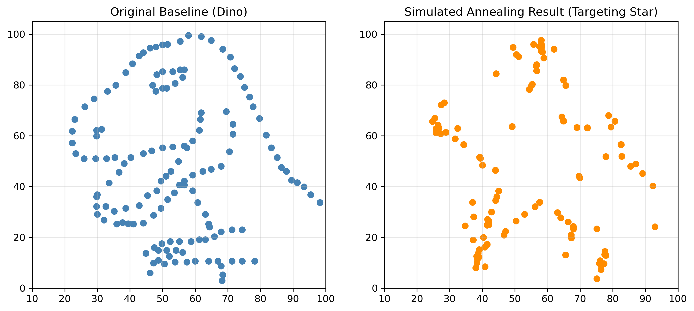

<div align="center">
  <h1>🦖 Same Stats, Different Graphs</h1>
  <h3>Statistical Validation and Geometric Morphing via Simulated Annealing</h3>
  
  [](https://www.python.org/)
  [](https://numpy.org/)
  []()
</div>
Ritik Joshi (Reg No: 26-27-16) - M.Tech Data Science
Anirudhha Pandey (Reg No: 26-27-17) - M.Tech Data Science
Sourabh Dang (Reg No: 26-27-18) - M.Tech Data Science
Astha Deshmukh (Reg No: 26-14-06) - M.Tech Modeling & Simulation
---

## 📌 Project Synopsis & Objectives

This project explores the critical limitations of summary statistics in data visualization, demonstrating how radically divergent spatial geometries can share identical statistical signatures. It transitions from foundational mathematical proofs to advanced stochastic optimization.

The project was executed across **four core implementations**:
1. **Pure NumPy Statistical Engineering:** Computing Mean, Variance, Pearson correlation ($r$), and Ordinary Least Squares (OLS) regression strictly using pure NumPy, prohibiting "black-box" libraries (e.g., SciPy, scikit-learn).
2. **Anscombe's Quartet Validation:** Proving manually that the four distinct datasets in Anscombe's Quartet share identical baseline statistics.
3. **Datasaurus Dozen Validation:** Expanding the mathematical proof to 13 complex geometric datasets, verifying their statistical equivalence.
4. **Stochastic Shape Morphing:** Implementing a Simulated Annealing algorithm to morph a starting point cloud (`dino`) into a target geometry (`star`) while strictly restricting statistical drift.

---

## 🗂️ Repository Architecture

The repository is structured sequentially across four primary Jupyter Notebooks to strictly isolate the ETL pipeline from the downstream mathematical processing:

```text
📦 Same-Stats-Different-Graphs
 ┣ 📂 Data
 ┃ ┣ 📂 Cleaned_Data
 ┃ ┃ ┣ 📜 anscombe.csv
 ┃ ┃ ┣ 📜 anscombe_clean.csv
 ┃ ┃ ┣ 📜 datasaurus.csv
 ┃ ┃ ┗ 📜 datasaurus_clean.csv
 ┃ ┗ 📂 Raw_Datasets
 ┃   ┣ 📂 same-stats-different-graphs-master
 ┃   ┗ 📂 seaborn-data-master
 ┣ 📂 Notebook
 ┃ ┣ 📜 01_data_cleaning_sourabh.ipynb       # ETL Pipeline & Data Sanitization
 ┃ ┣ 📜 02_anscombe_stats_ritik.ipynb        # Anscombe's Quartet Baseline Math
 ┃ ┣ 📜 03_datasaurus_stats_processing.ipynb # Datasaurus Dozen Validation
 ┃ ┗ 📜 04_simulated_annealing.ipynb         # Stochastic Optimization Engine
 ┣ 📂 Assets
 ┃ ┣ 🖼️ anscombe.png
 ┃ ┣ 🖼️ dino.png
 ┃ ┗ 🖼️ star_sa.png
 ┣ 📂 Report
 ┃ ┣ 📜 main.tex                             # LaTeX Source Code
 ┃ ┗ 📜 Same_Stats__Different_Graphs.pdf     # Final Compiled Report
 ┣ 📂 Presentation
 ┃ ┣ 📜 Same Stats, Different Graphs (PPT).pptx
 ┃ ┗ 📜 Same Stats, Different Graphs PPT (PDF).pdf
 ┗ 📜 README.md
```

---

## ⚙️ Phase 1 & 2: Baseline Mathematical Validation

Before any optimization occurred, the data was strictly sanitized (handling nulls, duplicates, and `float64` casting). We then established immutable statistical baselines for all 17 datasets (4 Anscombe, 13 Datasaurus).

For our primary target subset (`dino`), the custom NumPy functions confirmed the following strict baseline:
* **Mean (X, Y):** 54.2633, 47.8323
* **Variance (X, Y):** 281.0700, 725.5160
* **Pearson Correlation:** -0.0645

---

## 🚀 Phase 3: Simulated Annealing Engine

The final implementation manipulates coordinates to form a new target geometry (`star`) without triggering statistical alarms. 

* **The Gatekeeper:** Perturbations are accepted only if the new variance or correlation deviates from the original `dino` baseline by a strict mathematical tolerance of `≤ 0.1`.
* **The Objective Function:** Moves that decrease the Euclidean distance to the target `star` geometry are accepted. To escape local minima, moves increasing spatial cost are accepted probabilistically based on the system temperature $T$: $P = e^{(-\Delta \text{Cost} / T)}$.

**Performance Metrics:**
* **Iterations:** 150,000 | **Cooling Rate:** 0.9995
* **Cost Reduction:** 80.35% (Initial: 1103.80 $\rightarrow$ Final: 216.86)

---

## 📊 Visual Proof

<div align="center">
  
</div>

> **Note on Geometric "Noise":** The slight geometric scattering observed in the final star shape is the direct physical manifestation of the strict mathematical constraints holding the variance and correlation steady. The algorithm found the absolute closest physical approximation of a star that mathematically still acts like a dinosaur.

---

## 👥 Team & Contributions

* **Aniruddha:** Project Lead, Architecture Design & Simulated Annealing Engine
* **Sourabh:** ETL Pipeline & Data Sanitization Framework
* **Ritik:** Pure NumPy Baseline Mathematical Proofs
* **Astha:** LaTeX Reporting, Visualization, & Project Documentation

---

## 💻 How to Run

1. Clone the repository: `git clone https://github.com/Anniendl/Same-Stats-Different-Graphs.git`
2. Ensure dependencies are installed: `pip install numpy pandas matplotlib`
3. Execute the notebooks sequentially from `01` to `04` to trace the data pipeline from raw ingestion to final geometric morphing.
